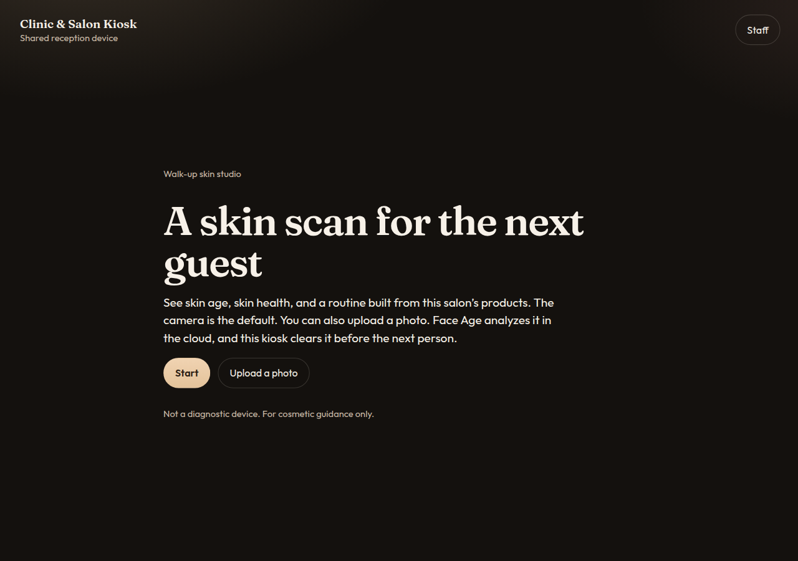
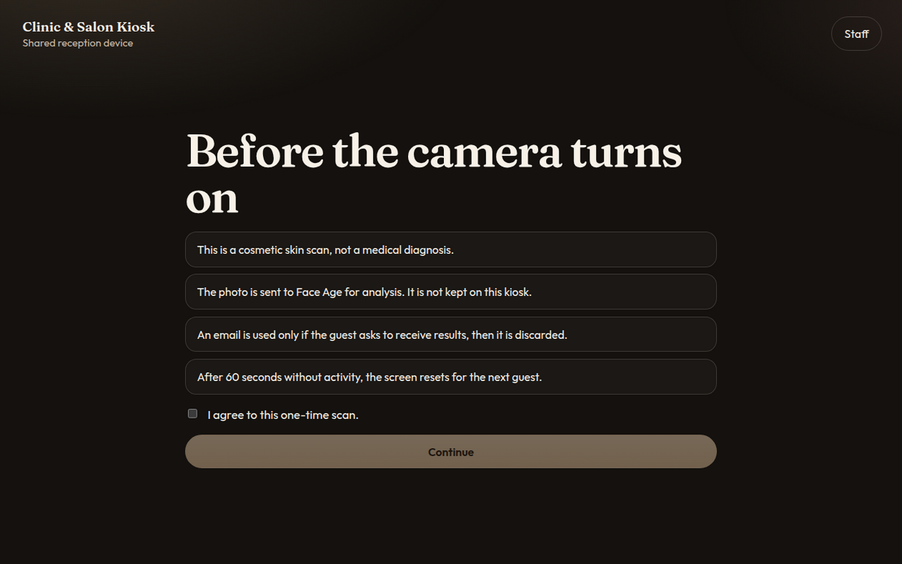
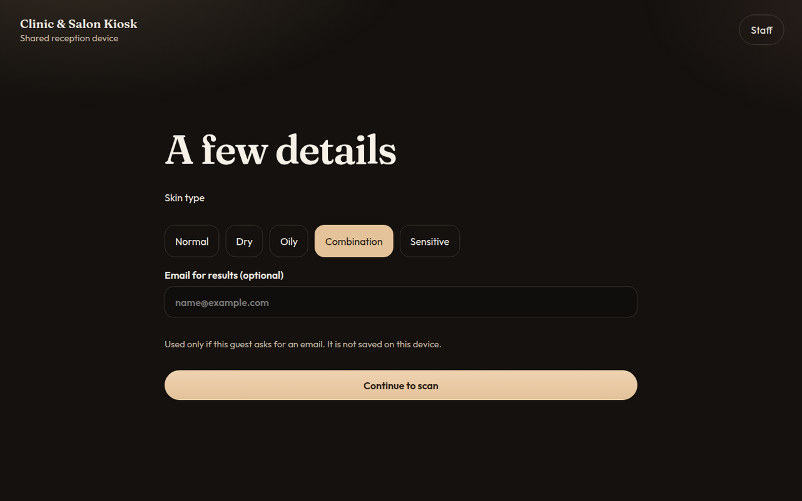
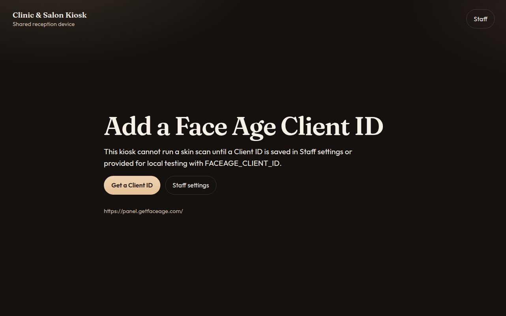
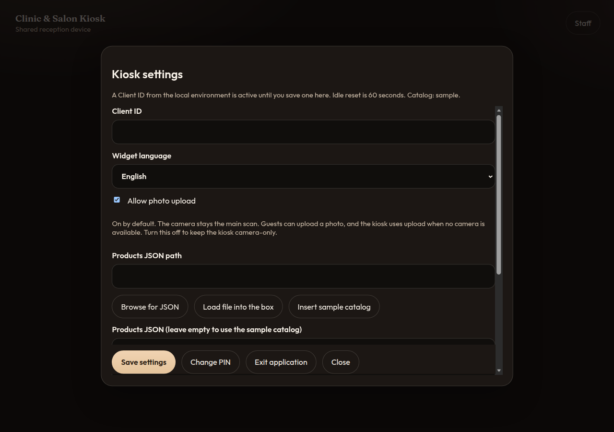

# Clinic & Salon Kiosk — Walk-up Face Age Skin Scan for Salons and Clinics

Clinic & Salon Kiosk is a full-screen [Electron](https://www.electronjs.org/) app for beauty salons, cosmetic clinics, pharmacies, and trade-show booths. A guest taps Start, agrees to a one-time scan, answers a short skin quiz, and reviews skin age, skin health, problem scores, and a routine built from that location’s products. Results can be emailed or saved as a PDF through the [Face Age](https://getfaceage.com) skin analysis SDK. The shared device then wipes the visit and resets for the next person.

The scanner is the [`face-age`](https://www.npmjs.com/package/face-age) widget. Photos are analyzed in the Face Age cloud. This kiosk is a cosmetic guide, not a diagnostic device.



## Features

- Locked full-screen kiosk for a reception tablet or PC with a webcam
- Consent shown before every scan, with a plain statement that this is not a medical device
- Face Age quiz turned on, with skin type and email collected for the visit
- Skin age, skin health, and the widget’s problem scores after a face scan
- Salon catalog pushed in with `setCustomProducts`, including a sample product file
- **Email me my results** calls `submitSdkIntegration` and does not keep the address
- **PDF report** calls `getReportPdf` when the Face Age plan allows it
- Idle reset after 60 seconds, plus a staff-controlled finish button
- PIN-gated staff settings for Client ID, products JSON, and widget language
- No guest photos, results, or emails stored on the device by default

## How it works

1. The salon leaves a tablet or PC running the kiosk at reception.
2. A guest taps **Start**, accepts consent, chooses a skin type, and can enter an email.
3. The Face Age widget opens in the page, runs its quiz, and scans the face with the webcam.
4. The guest sees skin age, skin concerns, and a routine that uses the salon’s products.
5. **Email me my results** sends that visit through `submitSdkIntegration`. **PDF report** requests a plan-based report.
6. After 60 seconds without touch, mouse, or keyboard activity — or when the guest taps **Finish** — the kiosk clears the visit and returns to the welcome screen.





## Quick start

Requirements: Node.js 22 or newer, npm, and a webcam for a live scan.

### Install dependencies

```bash
npm install
```

### Install the latest face-age package

Install the latest [`face-age`](https://www.npmjs.com/package/face-age) skin analysis package on its own, before you build, package, or start the kiosk:

```bash
npm install face-age@latest
```

That command installs the current Face Age release from npm and copies the widget the kiosk serves. Run it again whenever you want a newer skin scan widget, then build.

### Configure and start

Copy the environment template and start the app:

```bash
cp .env.example .env.local
npm run dev
```

`npm run dev` opens a windowed preview so you can use the developer tools. A production launch (`npm start` after `npm run build`, or a packaged app) locks full-screen kiosk mode. Set `KIOSK_MODE=0` when you need a normal window.

UI preview without Electron, from the dev server:

- Welcome: `http://127.0.0.1:5173/?demo=1&shot=attract`
- Consent: `http://127.0.0.1:5173/?demo=1&shot=consent`
- Quiz: `http://127.0.0.1:5173/?demo=1&shot=quiz`
- Missing Client ID: `http://127.0.0.1:5173/?demo=1&shot=missing-id`
- Staff settings: `http://127.0.0.1:5173/?demo=1&shot=settings`

A live camera scan is not shown in the screenshots. It needs a webcam, a network connection, and a Client ID.

## Configuration

### Client ID

Create a Client ID in the Face Age panel: [https://panel.getfaceage.com/](https://panel.getfaceage.com/).

The kiosk never ships with a Client ID. Set one in either place:

- **Staff settings** on the device (saved with `electron-store` in the OS user data folder)
- **Local testing only:** put the local testing Client ID `0pHjKgVyHdZQyOwugAXH` in gitignored `.env.local`

```bash
FACEAGE_CLIENT_ID=0pHjKgVyHdZQyOwugAXH
```

A value saved in Staff settings overrides the environment variable. If neither is set, the kiosk tells staff to add a Client ID and links to the panel.



Open staff settings with the **Staff** button, by pressing **F8**, or by tapping the title five times. The first-run PIN is `2580`. Change it before guests use the device.



### Products

`sample/salon-products.json` is a fictional Lumen Atelier catalog. The widget receives it through `API.setCustomProducts()` until staff replace it.

In staff settings you can:

- Paste products JSON
- Point at a `.json` file on disk
- Insert the sample catalog and edit it

Leave the JSON box empty to keep using the sample file. Product images and links must be `http` or `https` URLs. Problem keys follow the Face Age list: `fineWrinkles`, `eyeWrinkles`, `deepWrinkles`, `darkCircle`, `eyeBag`, `pores`, `pigment`, `redness`, `oiliness`, `dryness`, `sagginess`, `dullness`, and `acne`.

### Language

The staff language list follows the codes supported by Face Age, with English as the default. Persian is not offered. The choice changes the widget language. The kiosk chrome stays in English.

### Scripts

| Script | Purpose |
| --- | --- |
| `npm run dev` | Vite plus Electron in a window |
| `npm run build` | Compile the main process and the renderer. Run `npm install face-age@latest` first |
| `npm start` | Launch the built app in kiosk mode |
| `npm test` | Unit tests |
| `npm run lint` | ESLint |
| `npm run typecheck` | Typecheck Electron and the renderer |
| `npm run pack` | Unpacked electron-builder directory for this OS |
| `npm run dist` | Installers (Windows NSIS, macOS dmg, Linux AppImage) |

`npm run dist` is meant to run on each target operating system. This repository’s Linux check builds an unpacked directory with `npm run pack` when the toolchain is available.

## Privacy

This is a shared device.

- Consent is required at the start of every session.
- The photo is analyzed by Face Age in the cloud. See [getfaceage.com](https://getfaceage.com).
- The widget is created with `history: false`, so scans are not written into the widget history store.
- Guest email lives in memory only long enough to call `submitSdkIntegration`. It is not written to settings.
- Idle reset, **Finish**, and the widget reset clear web storage, the HTTP cache, and any PDF saved for that visit.
- Upload from the device disk is off. The scan uses the webcam.
- The kiosk is not a medical device and does not provide a diagnosis.

Staff settings (Client ID, catalog, language, PIN) stay on the device. They are not guest data.

## FAQ

### Is this a diagnostic or medical device?

No. It is a cosmetic skin scan for a salon or clinic counter. It does not replace a clinician.

### Where does the photo go?

The Face Age widget sends the photo to the Face Age cloud for analysis. The kiosk deletes local widget state, storage, and temporary report files when the session ends.

### What if no Client ID is set?

The scan does not start. Staff see a message with a link to [https://panel.getfaceage.com/](https://panel.getfaceage.com/).

### Why did the email or PDF fail?

Email requires a finished analysis and a valid address. PDF reports depend on the Face Age plan. A plan without PDF access shows an on-screen explanation; the skin results in the widget still work.

### How does a staff member leave kiosk mode?

Open staff settings, enter the PIN, and choose **Exit application**. While kiosk mode is locked, closing the window from the guest screen is ignored.

### Does the scanner work offline?

The shell can open offline. A scan, email, and PDF need a network connection to Face Age.

## Stack

Electron, Vite, TypeScript, electron-builder, and electron-store. The skin widget is [`face-age`](https://www.npmjs.com/package/face-age) from [getfaceage.com](https://getfaceage.com). The page hosts `<div id="FaceAge-module"></div>` directly. The widget’s own internal frame is part of the SDK and is not modified.

## License

MIT. See [LICENSE](LICENSE).
